# Intraday volatility forecasting: microstructure features, walk-forward evaluation, transaction costs

Forecasting next-day and next-hour **realised volatility** of BTC/USDT and ETH/USDT from 5-minute
returns plus volume / taker-flow / spread-proxy features, comparing HAR-RV, GARCH/GJR-GARCH,
gradient boosting and a small LSTM under a strict walk-forward protocol (QLIKE, MSE, Diebold-Mariano),
and then using the forecasts for a **volatility-targeting position-sizing illustration with explicit costs**.

> **This repository is a forecasting and risk-management study. It does not contain, and does not claim,
> a profitable trading strategy.** The sizing experiment is judged on how well it controls risk, and
> in this sample it does *not* improve return or Sharpe versus buy-and-hold (see below).

Everything below is reproduced by the code in this repo from public data; every number in the tables
is copied from `reports/results/*.csv`.

## Data

* **Source:** Binance public market data, `data.binance.vision` spot monthly 1-minute klines, BTCUSDT and
  ETHUSDT, Jan 2019 - Sep 2026. No login, no API key. Raw zips are checked against Binance's published
  SHA-256 file, parsed as CSV in memory (never extracted/executed) and kept in `data/raw/` (git-ignored).
* 4.07 M one-minute bars per symbol; 0.10 % of minutes are missing (exchange downtime). Days with >10 % of
  minutes missing are dropped (10 days for BTC between 2019 and Aug 2021; three of them fall inside the out-of-sample window and are simply excluded from evaluation).
* Processed 1-minute parquet (DuckDB) and daily features in `data/processed/` (git-ignored, rebuilt by the CLI).
* A "day" is a UTC calendar day (crypto trades 24/7), 288 five-minute bars.

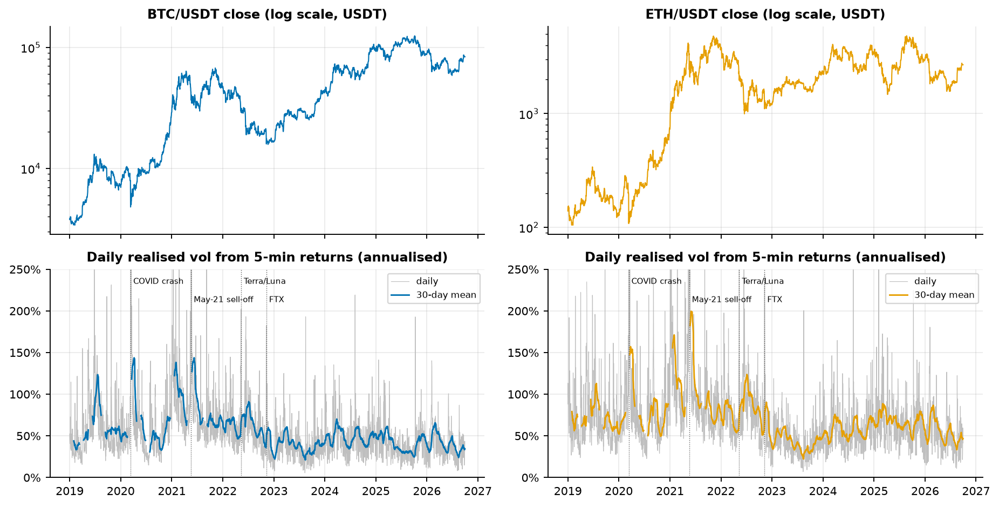

### Stylised facts that motivate the models

| | |
|---|---|
| 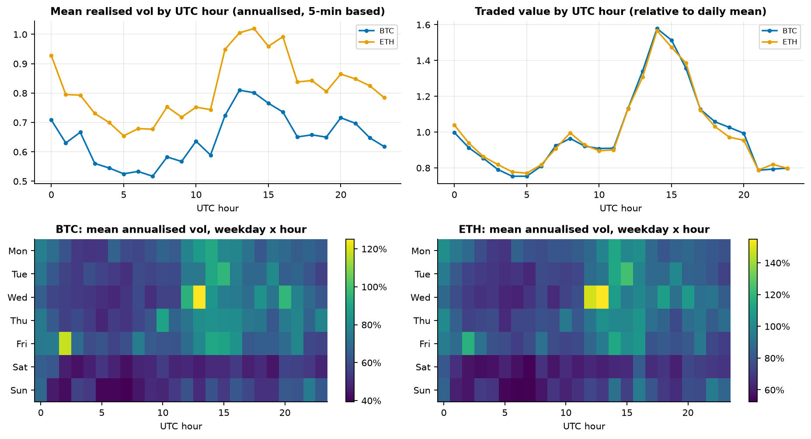 | 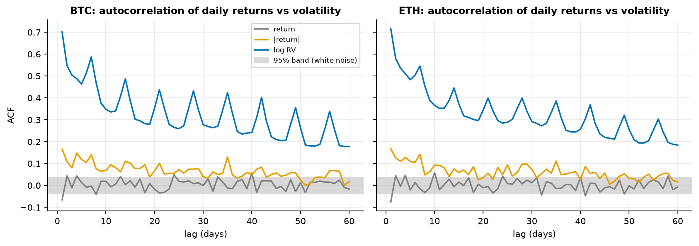 |
| Strong intraday and weekday seasonality (volatility and volume peak in the US/EU overlap, weekends are quiet). This is why a weekday term matters in the results below. | Returns are nearly uncorrelated; |returns| and log RV are strongly and persistently autocorrelated (long memory) which is what HAR exploits. |

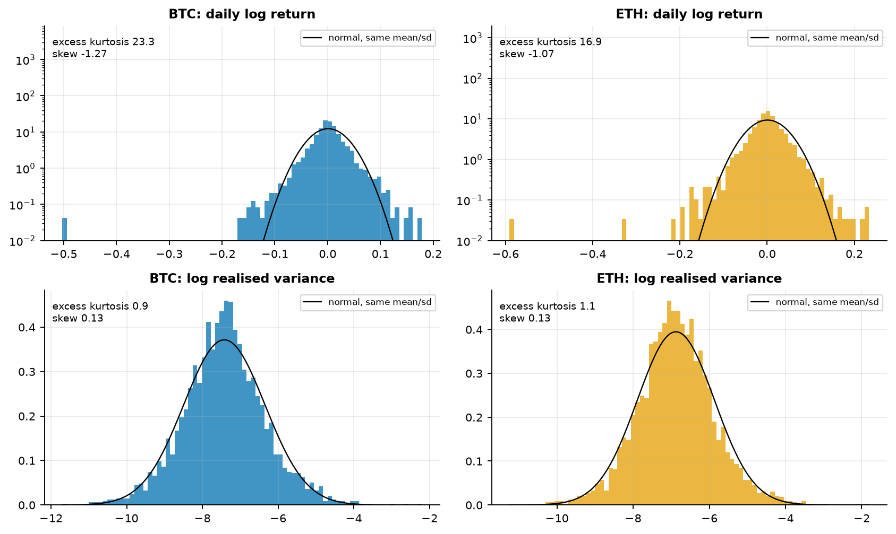
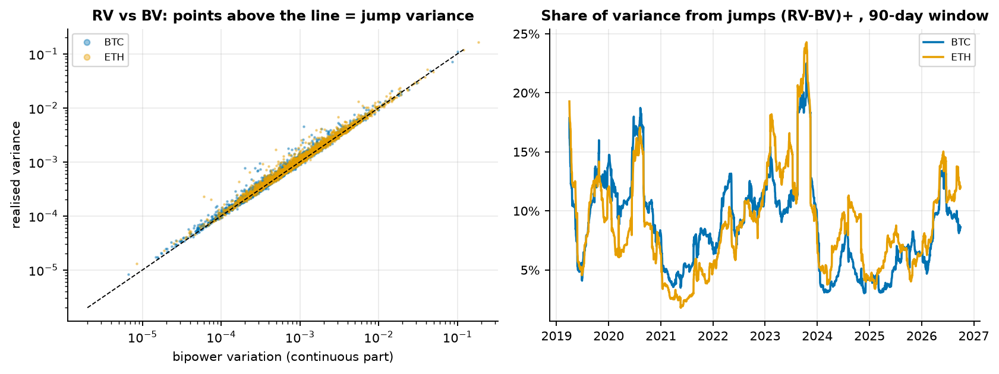

## Features (all known at the end of period *t*)

* **Realised variance** from 5-minute log returns, **bipower variation**, jump variance `max(RV-BV,0)` and share,
  negative semivariance share, share of variance in the last 4 hours of the day.
* **HAR lags:** log RV at 1 day, 7-day and 30-day means.
* **Volume / flow:** log traded value, log trade count, **taker-buy imbalance** `(2*taker_buy_base - volume)/volume`
  (Binance provides taker-buy volume), Amihud-style illiquidity.
* **Spread proxies** (no order book is available): Corwin-Schultz (2012) high-low estimator (two consecutive
  daily bars) and Roll (1984) from 1-minute return autocovariance.
* **Seasonality:** weekday of the target day (daily model), hour of the target hour (hourly model).

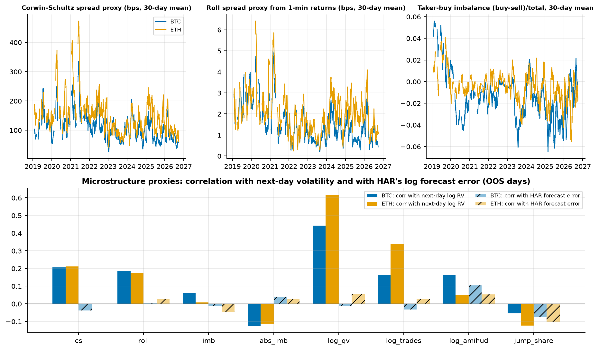

Spread proxies and volume are informative about *level* of volatility (top bars) but add little beyond the HAR
lags once the HAR forecast is known (hatched bars: correlation with HAR's log forecast error is ~0). The
Corwin-Schultz values here (~100 bps daily) are dominated by the daily range, i.e. by volatility itself, not by the
true quoted spread of these very liquid pairs; treat them as a volatility-liquidity proxy, not a cost estimate.

## Models

| Model | Description |
|---|---|
| Naive | tomorrow's RV = today's RV |
| **HAR** (baseline) | OLS on log RV: daily, weekly (7d), monthly (30d) |
| HAR-DoW | HAR + weekday dummies of the target day *(added after the first GBM result, see "Honest notes")* |
| HAR-X | linear OLS on all GBM features + weekday dummies *(same)* |
| GARCH(1,1), GJR-GARCH(1,1) | `arch` package, constant mean, Student-t, daily close-to-close returns; parameters refit every 30 days, variance recursion run forward with fixed parameters |
| GBM | gradient boosted trees (scikit-learn `HistGradientBoostingRegressor`), early stopping on a chronological validation tail |
| LSTM | 1 layer, 16 units, 30-day sequences of the base features, 3-seed average |

All ML/HAR models predict log RV and return `exp(pred) * smearing`; the smearing factor (Duan) is estimated on
training data only (HAR: in-sample residuals; GBM/LSTM: chronological validation tail). Hyper-parameters
were fixed up front and never tuned on the evaluation period.

## Evaluation protocol (no look-ahead)

* **Timing:** row *t* holds only information up to the end of day *t*; target = RV of day *t+1*.
* **Expanding-window walk-forward:** minimum 730 training days, re-fit every 30 days, 1-step-ahead forecast at
  every origin. A fit at origin *s* uses rows <= *s-1* only, i.e. targets already realised by end of day *s*.
* Out-of-sample: 2,012 days per symbol (Jan 2021 - Sep 2026) for the daily task; 49,227 hours for the hourly task.
* **Losses:** QLIKE (`RV/f - log(RV/f) - 1`, Patton 2011) and MSE on variance levels. **Diebold-Mariano** tests vs HAR
  with Newey-West variance and Harvey-Leybourne-Newbold correction (positive t = model better than HAR).
* **Leakage tests** (`pytest`): features recomputed on data truncated at day *t* are identical for all rows <= *t*;
  perturbing prices/volumes after *t* leaves features at *t* unchanged; a meta-test shows a deliberately leaky
  feature *is* flagged; walk-forward folds train only on realised targets; GARCH forecasts at *t* are unchanged by
  later returns.

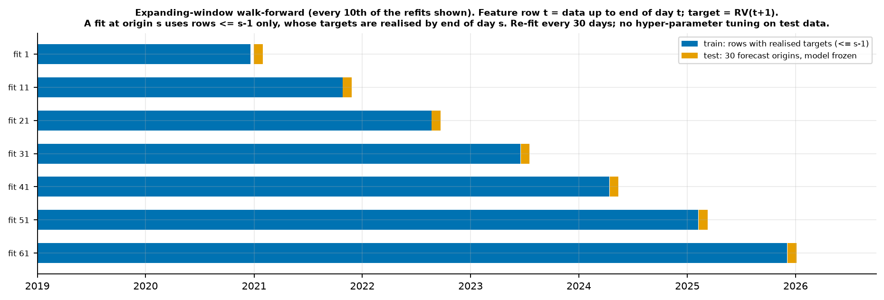

## Results - next-day volatility (out of sample)

MSE is in units of 1e-6 (variance^2) and is dominated by a few spike days; QLIKE is the more informative loss.
Ratios are relative to HAR (<1 = better). `p` is the Diebold-Mariano p-value vs HAR.

**BTCUSDT**

| Model | QLIKE | QLIKE / HAR | p | MSE (1e-6) | MSE / HAR | p |
|---|---|---|---|---|---|---|
| Naive | 0.476 | 1.564 | <0.001 | 1.591 | 1.399 | 0.001 |
| **HAR** | 0.304 | 1 | | 1.138 | 1 | |
| HAR-DoW | 0.250 | 0.822 | <0.001 | 1.082 | 0.951 | 0.001 |
| HAR-X (linear) | **0.234** | **0.768** | <0.001 | 1.097 | 0.964 | 0.450 |
| GARCH(1,1) | 0.399 | 1.310 | <0.001 | 1.349 | 1.186 | <0.001 |
| GJR-GARCH | 0.402 | 1.320 | <0.001 | 1.382 | 1.215 | <0.001 |
| GBM | 0.253 | 0.830 | <0.001 | **1.063** | **0.935** | 0.005 |
| LSTM | 0.297 | 0.976 | 0.705 | 1.188 | 1.045 | 0.278 |

**ETHUSDT**

| Model | QLIKE | QLIKE / HAR | p | MSE (1e-6) | MSE / HAR | p |
|---|---|---|---|---|---|---|
| Naive | 0.383 | 1.475 | <0.001 | 3.293 | 1.338 | 0.001 |
| **HAR** | 0.260 | 1 | | 2.462 | 1 | |
| HAR-DoW | 0.226 | 0.868 | <0.001 | 2.375 | 0.965 | 0.012 |
| HAR-X (linear) | **0.221** | **0.852** | <0.001 | 2.376 | 0.965 | 0.220 |
| GARCH(1,1) | 0.361 | 1.389 | <0.001 | 3.085 | 1.253 | <0.001 |
| GJR-GARCH | 0.364 | 1.402 | <0.001 | 3.120 | 1.267 | <0.001 |
| GBM | 0.222 | 0.856 | 0.001 | 2.442 | 0.992 | 0.811 |
| LSTM | 0.248 | 0.954 | 0.304 | 2.461 | 1.000 | 0.989 |

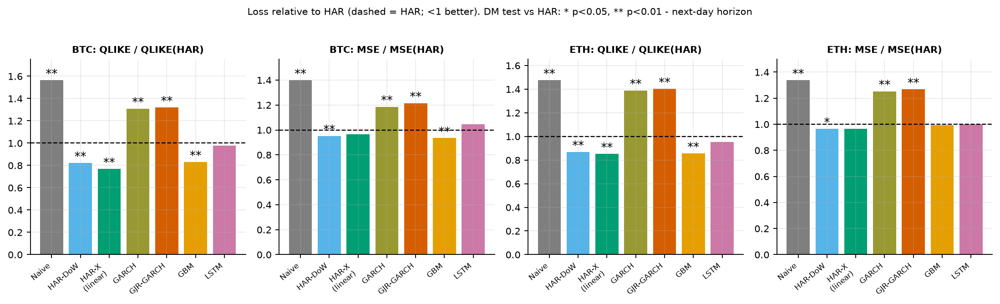

**What the numbers say**

* Plain HAR is a strong baseline: daily-return GARCH/GJR are ~30-40 % worse in QLIKE, and the naive forecast ~50 % worse.
* GBM beats HAR on QLIKE (-17 % BTC, -14 % ETH, DM p<0.01), **but a linear HAR with weekday dummies recovers most of
  it** (-18 % / -13 %) and the linear HAR-X (best QLIKE on both) matches or beats GBM. Permutation importance
  (below) shows the weekday is the dominant GBM feature. The honest reading is: *HAR misses the weekday effect; trees add
  little beyond it*. The microstructure/flow features add a small further QLIKE gain in the linear model
  (HAR-DoW -> HAR-X: 0.250 -> 0.234 BTC, 0.226 -> 0.221 ETH); I did not test whether that gain is statistically significant.
* The small LSTM is not distinguishable from HAR (p = 0.71 / 0.30).
* The advantage over HAR is not constant: it is largest in 2024-2026 (QLIKE ratio of HAR-X 0.71 / 0.72 / 0.62 for BTC in
  2024 / 25 / 26, vs 0.98 in 2021; `reports/results/daily_qlike_ratio_by_year_*.csv`). I did not investigate why.

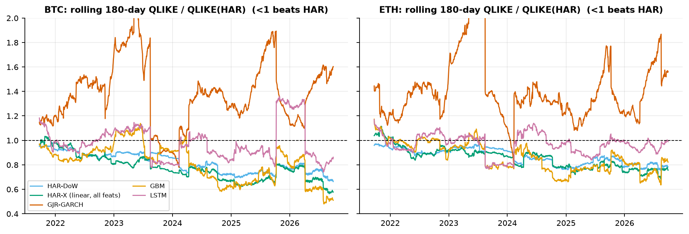
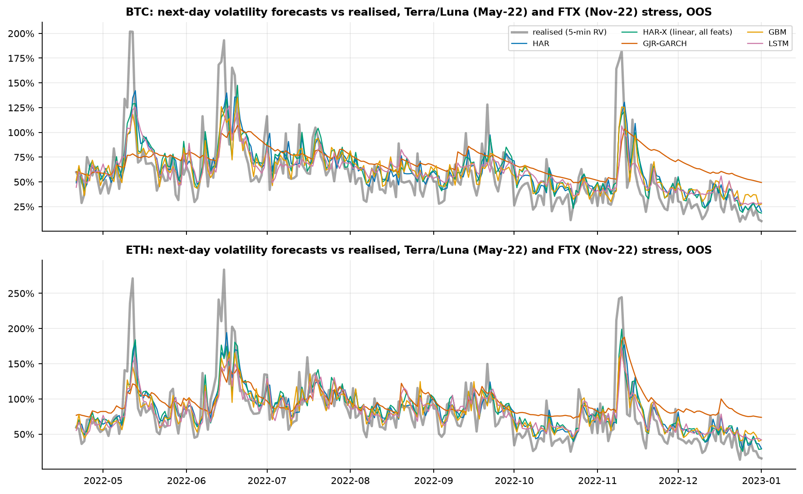

| | |
|---|---|
| 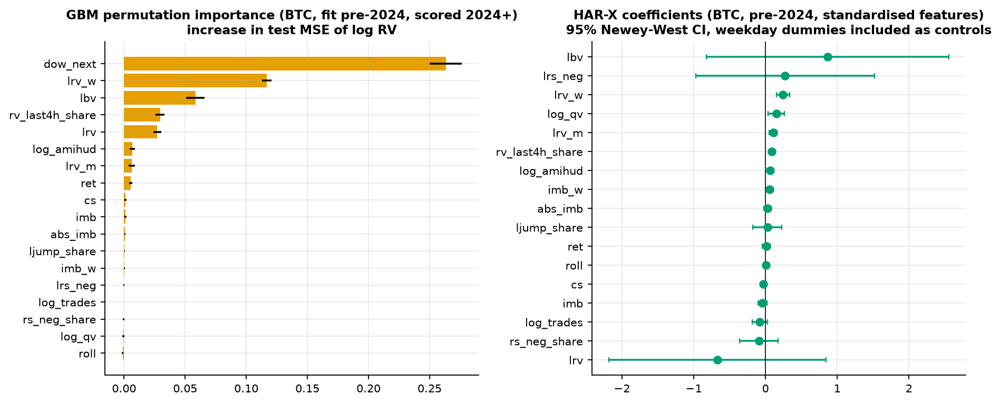 | 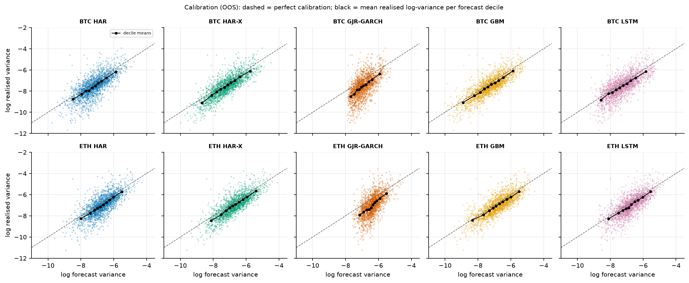 |

(The HAR-X coefficient plot has very wide CIs on `lrv` / `lbv`: they are almost collinear (RV vs BV), so individual
coefficients are unreliable even though the forecast is fine. Importance/coefficient panels use a single pre-2024 fit.)

## Results - next-hour volatility (out of sample)

HAR (3 lags), HAR-S (HAR + hour-of-day dummies) and GBM; 49,227 OOS hours per symbol, same walk-forward protocol (re-fit
every 30 days).

| Symbol | Model | QLIKE | QLIKE / HAR | p | MSE / HAR | p |
|---|---|---|---|---|---|---|
| BTC | Naive | 0.798 | 1.645 | <0.001 | 1.484 | 0.050 |
| BTC | **HAR** | 0.485 | 1 | | 1 | |
| BTC | HAR-S | 0.466 | 0.960 | <0.001 | 0.993 | 0.248 |
| BTC | GBM | 0.459 | 0.947 | <0.001 | 1.013 | 0.579 |
| ETH | Naive | 0.781 | 1.656 | <0.001 | 1.133 | 0.257 |
| ETH | **HAR** | 0.472 | 1 | | 1 | |
| ETH | HAR-S | 0.452 | 0.958 | <0.001 | 0.998 | 0.577 |
| ETH | GBM | 0.449 | 0.951 | <0.001 | 1.069 | 0.402 |

Intraday seasonality is worth ~4-5 % of QLIKE at the hourly horizon; by MSE (spike-dominated) no model is distinguishable from HAR.

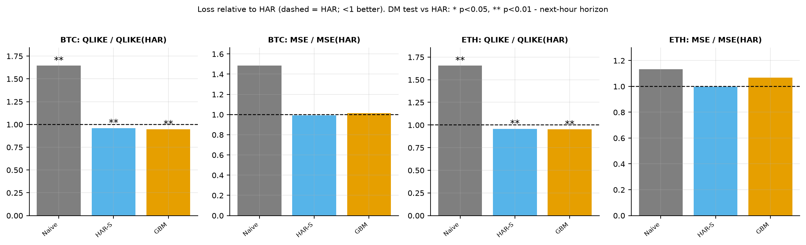
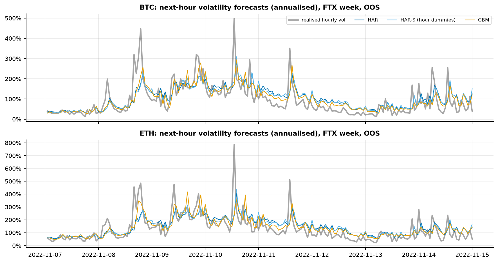

## Use case: volatility targeting with transaction costs (risk-management illustration)

Rule: `w_t = min(1, 40% / forecast annualised vol_{t+1})`, long-only spot, **no leverage** (cap 1), decided at the
close of day *t* from the forecast made at that close, earning day *t+1*'s close-to-close return. Costs: **10 bps one-way**
on the traded notional, computed from the drifted pre-trade weight (so turnover is exact), charged on the next day's return.
Sensitivity 0 / 5 / 10 / 20 / 50 bps is in `reports/results/sizing_*.csv`. Same 2,012 OOS days. Figures at 10 bps:

| BTC | ann. vol | 30d-vol RMSE vs 40 % target | max DD | ann. return | Sharpe | ann. turnover | avg weight |
|---|---|---|---|---|---|---|---|
| Buy & hold (w=1) | 55.0 % | 21.1 % | -76.6 % | 24.2 % | 0.67 | 0.2x | 1.00 |
| Vol-target, HAR | 37.3 % | 7.5 % | -62.1 % | 12.4 % | 0.50 | 27.7x | 0.76 |
| Vol-target, GJR-GARCH | 34.9 % | 9.6 % | -56.3 % | 17.1 % | 0.63 | 6.5x | 0.69 |
| Vol-target, GBM | 37.1 % | 7.9 % | -61.2 % | 10.9 % | 0.46 | 32.1x | 0.78 |
| Vol-target, HAR + 10 % no-trade band | 37.3 % | 7.7 % | -62.1 % | 14.1 % | 0.54 | 20.8x | 0.76 |
| Static weight = mean HAR weight | 41.9 % | 13.6 % | -65.6 % | 21.1 % | 0.67 | 1.4x | 0.76 |
| *Oracle: true next-day RV (look-ahead, upper bound only)* | 33.7 % | 8.4 % | -45.6 % | 31.8 % | 0.99 | 41.1x | 0.81 |

| ETH | ann. vol | 30d-vol RMSE vs 40 % target | max DD | ann. return | Sharpe | ann. turnover | avg weight |
|---|---|---|---|---|---|---|---|
| Buy & hold (w=1) | 72.6 % | 36.0 % | -79.3 % | 6.2 % | 0.45 | 0.2x | 1.00 |
| Vol-target, HAR | 40.8 % | 8.0 % | -55.7 % | 7.1 % | 0.37 | 27.9x | 0.63 |
| Vol-target, GJR-GARCH | 35.8 % | 9.3 % | -47.4 % | 12.1 % | 0.50 | 7.3x | 0.52 |
| Vol-target, GBM | 41.2 % | 7.8 % | -57.5 % | 5.9 % | 0.34 | 34.3x | 0.65 |
| Vol-target, HAR + 10 % no-trade band | 40.8 % | 8.2 % | -55.4 % | 8.5 % | 0.40 | 21.3x | 0.62 |
| Static weight = mean HAR weight | 45.5 % | 13.9 % | -60.8 % | 10.2 % | 0.44 | 2.4x | 0.63 |
| *Oracle (look-ahead)* | 36.6 % | 5.9 % | -39.1 % | 35.3 % | 1.01 | 47.1x | 0.70 |

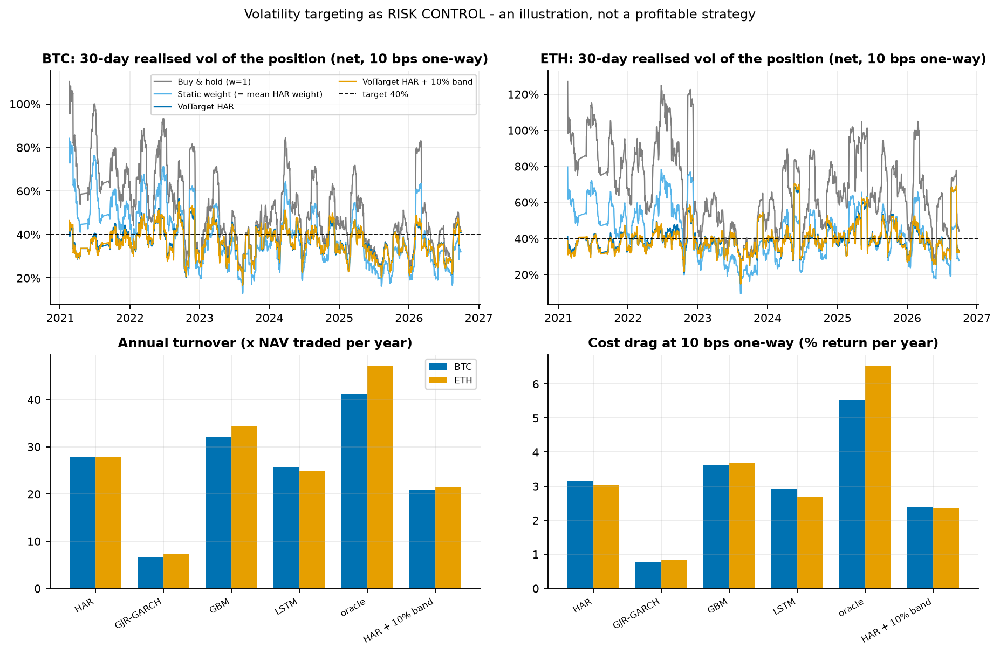
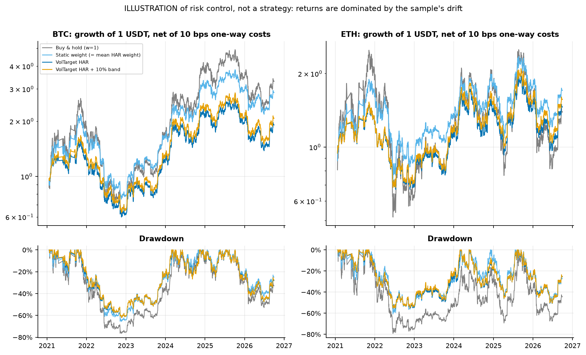

**Reading it correctly**

* **What works as risk control:** the realised volatility of the position is pulled from 55 % / 73 % (BTC / ETH
  buy-and-hold) toward the 40 % target, the dispersion of 30-day realised vol is ~2.7x lower, the worst day is cut (BTC -15.4 % -> -9.3 %)
  and max drawdown is shallower for ETH (-79 % -> -56 %) and modestly so for BTC.
* **What does not:** Sharpe and return are **not** improved by the forecast-based rule in this sample (BTC Sharpe 0.50 vs 0.67
  buy-and-hold; a static weight with the same average exposure does as well on return/Sharpe, with higher vol). Cost drag at
  10 bps is ~3 % per year of return for HAR-based sizing (27.7x annual turnover), ~2.4 % with a 10 % no-trade band, 0.8 % for GJR-GARCH
  sizing (smoother forecasts). At 50 bps HAR sizing's BTC Sharpe falls to 0.20 (from 0.57 gross).
* Returns are dominated by the sample's strong drift in 2021-2026 and the cap at 1.0. The oracle row is shown only to bound
  what perfect volatility knowledge would give; it uses the future and is not achievable.
* GARCH is the worst *forecaster* but the best *sizer* by turnover/Sharpe here: forecast loss and portfolio usefulness are different questions
  (smoother forecasts trade less), and I did not run a significance test on any portfolio metric. These are single-path, in-sample-period comparisons.

## Architecture & cost choices

* **Local, no cloud.** The whole problem is ~4 M one-minute rows x 2 symbols (a few hundred MB of zips, ~100 MB parquet) and
  models with a few thousand daily rows or ~50 k hourly rows; it fits on a laptop (DuckDB/pandas, scikit-learn, a 16-unit LSTM
  on CPU). A managed warehouse / GPU would add cost and operational surface without improving any result here; walk-forward
  refits are embarrassingly small. Thread usage is capped (`OMP_NUM_THREADS=4`) so the laptop stays usable.
* **Free, redistributable-to-describe data**, no API keys anywhere in the code; raw downloads are checksum-verified, parsed as
  plain CSV, git-ignored and never executed.
* **DuckDB + parquet** for storage and sanity queries, pandas for feature engineering, a flat `ivr` CLI / Makefile for reproducibility.
* **Cost choices in the use case:** 10 bps one-way is a deliberately round assumption in the range of a standard spot taker fee tier
  (check the current Binance fee schedule; it is lower for high volume / fee-token discounts) plus a little slippage; execution is
  assumed at the daily close price. The 0-50 bps sensitivity is reported so the conclusion does not hinge on it.

## Reproduce

```bash
make setup        # uv sync (Python 3.12)
make data         # download + verify + process Binance klines (~370 MB, ~25 min on a normal connection)
make all          # features, daily + hourly walk-forward, sizing, all figures  (tens of minutes on a laptop CPU)
make test         # pytest (leakage tests use synthetic data, no download needed)
```

`uv run ivr {download,process,daily,hourly,sizing,figures,all}` runs single stages. Outputs: `reports/results/*.csv`, `reports/figures/*.png`.

## Honest notes and limitations

* **Specification search after seeing results:** HAR-DoW and HAR-X were added *after* the first GBM-vs-HAR run showed a large GBM
  gain, to check whether it was the weekday effect. They are disclosed ablations, not pre-registered models; the DM p-values are
  not adjusted for multiple comparisons and I did not run a Model Confidence Set. Model hyper-parameters, windows and refit frequency were fixed beforehand.
* **Realised variance is a proxy**: 5-minute RV on one exchange (Binance spot, USDT quote), so forecast errors include measurement
  error and exchange-specific effects; absolute QLIKE levels (~0.2-0.5) mostly reflect that noise. USDT is not USD.
* **No order-book data:** spread estimators are OHLC-based proxies (see above); no true bid-ask, depth, or impact modelling.
* **GARCH** is fitted on daily close-to-close returns (UTC) and compared with a 5-minute-based RV target; between 30-day refits the variance
  recursion runs with fixed parameters. A GARCH on intraday returns or a realised-GARCH would likely do better; not done.
* **LSTM** is small, un-tuned and uses 3 seeds; its non-result should not be read as "deep learning cannot help".
* **Sizing:** one historical path, no leverage/short, no funding, borrowing, taxes or slippage beyond the flat bps cost, execution at close,
  and no significance tests on portfolio metrics. It is an illustration of risk control, nothing more.
* Only two highly correlated assets in one regime-heavy period (2021-2026); weekday patterns and the HAR-X advantage were
  stronger in later years and may not persist.
* Two hourly rows with zero traded volume are handled by clipping before the log (fixed, and the hourly results regenerated, before the numbers above).
